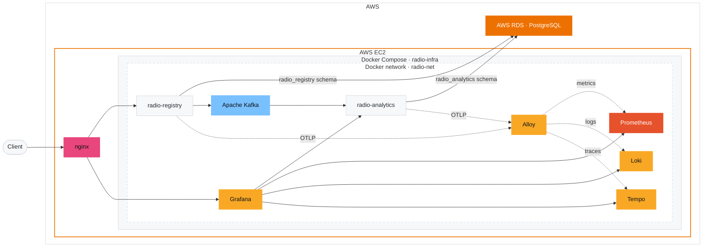
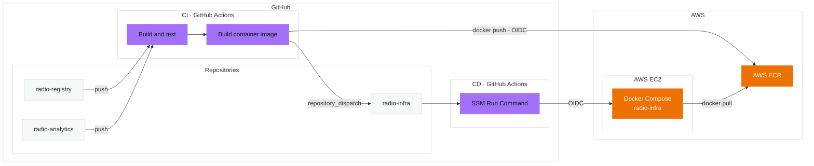

# Radio Ecosystem Orchestrator (Radio Infra)

Orchestration, observability, and deployment repository for the Radio ecosystem microservices.

This repository does not contain application code — it wires together the independent [`radio-registry`](https://github.com/giuliopetteno/radio-registry) and [`radio-analytics`](https://github.com/giuliopetteno/radio-analytics) microservices via Docker Compose, and drives their automated deployment to Amazon Web Services (AWS).

Microservices application traces, metrics, and logs are collected by **Alloy** and stored in **Prometheus** (metrics), **Tempo** (distributed traces), and **Loki** (logs).
**Grafana** ties the three signals together for visualization, dashboards, and trace-to-log correlation.

> **🚧 Work in Progress**
>
> This project is currently under active development and serves as a demonstration of modern DevOps and cloud infrastructure practices.

## Live Demo

Grafana dashboards are available at:
[`radio-analytics.giuliopetteno.dev`](https://giuliopetteno.s.gy/radio-analytics) *(short link for click tracking)*

- [`Radio Analytics - Insights`](https://radio-analytics.giuliopetteno.dev/d/adc7w8k/insights) → Business analytics for medical devices, including inventory, allocation, lifecycle, organizational structure, and activity trends, available both in real time and as scheduled, persisted reports
- [`Radio Analytics - Performance`](https://radio-analytics.giuliopetteno.dev/d/adflz27/performance) → Analytics engine execution monitoring, including outcomes, execution times, KPI status and performance, across both real-time and scheduled report executions
- [`Radio Ecosystem - Operations`](https://radio-analytics.giuliopetteno.dev/d/ad9wm9g/operations) → End-to-end observability of the entire ecosystem, including service dependencies, HTTP and Kafka traffic, logs, and distributed traces

> **Note:** Anonymous read-only access — no login required.

## Features

- Containerization
- Automated CI/CD pipeline
- Cloud deployment
- Full observability stack: distributed tracing, metrics, and structured logging with cross-signal correlation

## Architecture

- `radio-registry` — producer service (medical devices management system)
- `radio-analytics` — consumer service (medical devices analytics system)
- Services communicate exclusively via **Apache Kafka**; they share no code and are versioned in separate repositories
- A shared Docker network (`radio-net`) connects all containers
- Application code lives in the service repositories; the message broker and observability stack are defined and orchestrated here

## Deployment Modes

This repo supports three distinct Compose configurations:

- **`docker-compose.yml`** — local development. Uses Compose `include` to pull in each service's own compose file from sibling directories, building images from local source
- **`docker-compose.prod.yml`** — production-like local environment. Uses Compose `include` to pull in each service's own `.prod` compose file from sibling directories, building images from local source
- **`docker-compose.aws.yml`** — cloud production. Self-contained (no dependency on sibling repos being cloned), pulls pre-built images directly from Amazon ECR, and is the configuration deployed to EC2

## CI/CD Pipeline

## Technology Stack

- Containerization with Docker and Docker Compose
- Automated CI/CD with GitHub Actions
- Amazon Web Services (AWS) deployment:
  - EC2 (Docker Compose orchestration, IAM-only access via SSM)
  - ECR for container image registry
  - RDS (PostgreSQL, private subnet, EC2-scoped security group, SSM tunnel for local dev)
  - GitHub Actions → OIDC → ECR → SSM Run Command deploy
  - IAM: least-privilege roles throughout (GitHub Actions OIDC roles, EC2 instance role)
  - Secrets management via AWS Systems Manager Parameter Store
  - Nginx reverse proxy for name-based routing, with TLS via Let's Encrypt and automated renewal
  - DNS-based service routing under a custom domain (`giuliopetteno.dev`) via Route 53 with Elastic IP
- Observability stack:
  - Alloy as unified OpenTelemetry (OTLP) collector
  - Prometheus for metrics storage
  - Tempo for distributed trace storage
  - Loki for log aggregation
  - Grafana for dashboards, visualization, and trace-to-log correlation
